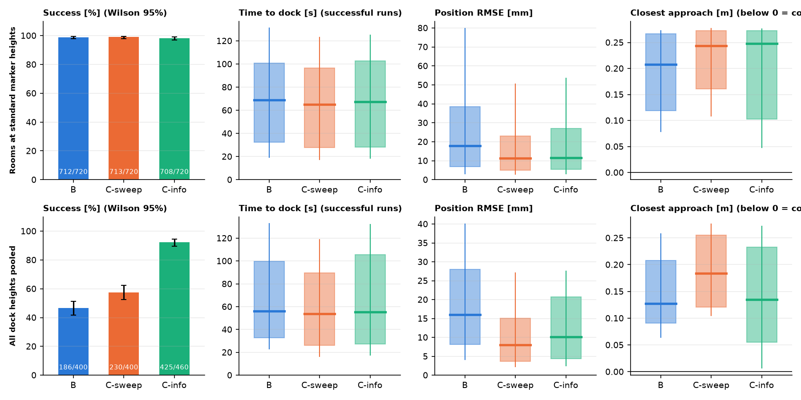
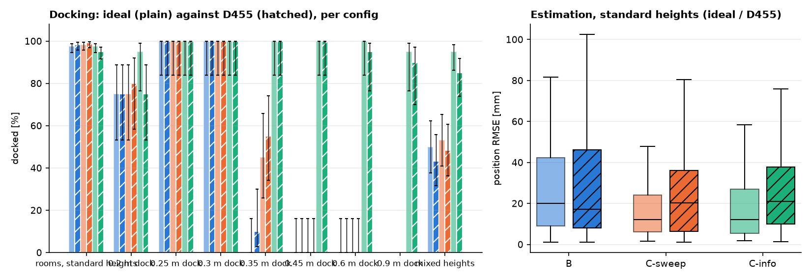

# Active Visual Navigation and Autonomous Docking

A TurtleBot3 Waffle Pi with a pan-tilt camera head, simulated in MuJoCo, searches an unknown room using only wheel odometry and one camera, finds an ArUco marker and docks on it. **Does actively moving the camera head help the robot know where it is and dock?**

**Course:** 41014 / 42043 Sensors and Control in Mechatronics Systems, Assessment 4 (Integrated Project) · **Track:** own project (Track A extension) · **Team:** Team 10


## Demo video
**[Watch the demo video (Google Drive)](https://drive.google.com/file/d/1PDyGCf_cWFDS-7GbgnAEWZXzLjs51qTt/view?usp=sharing)**

## 1. Summary

The robot is given no map, no marker positions and no starting pose. It must find marker 10 and dock 0.5 m in front of it, within 0.10 m and 5 degrees, without touching anything.
Three head behaviours are compared on identical trials (same room, start, layout and seed). Everything else (estimator, map, planner, controller) is the same.

| Config | Head | Behaviour |
|---|---|---|
| **B** | fixed | looks straight ahead, never moves |
| **C-sweep** | pan sweep | pans back and forth at a constant rate; tilt locked level |
| **C-info** | pan and tilt chosen | looks where it is least certain (unknown map, or markers when its position estimate is loose) and tilts to see the dock |

Config A (wheel odometry only) was used as the baseline in the early building blocks (the odometry-drift study and the EKF crossing study). It was not included in the comparison, as without a camera it could not detect or dock on a marker. As the project progressed towards a camera-only search and docking approach, with waypoint-based tasks no longer being used, Config A was no longer relevant and was dropped from the later experiments.

**Findings** (ideal camera, 300 s cap, 12 rooms, 95% intervals):

1. **Panning improves the position estimate.** Median position error is 17.9 mm for B and 11.2 / 11.5 mm for C-sweep / C-info (C-info minus B: -2.9 mm [-4.2, -1.9]).
2. **Tilting makes high docks possible.** Above about 0.33 m a level camera cannot see the whole plate from the standoff, so B and C-sweep never dock; C-info docks 59/60 at 0.45 m and 58/60 at 0.6 m.
3. **Choosing where to pan adds nothing measurable.** C-info and C-sweep have the same position error (+0.2 mm [+0.0, +0.4]) and docking rate in the standard rooms.
4. **It costs a little safety.** C-info touched an obstacle in 6 of 720 standard trials (B: 0), and tall docks in the most cluttered room succeed 25 of 30.
5. **A realistic camera keeps the conclusions** (section 5).

**Why C-info.** The information-driven head grew out of my master's thesis on MOXI, a concept social robot whose gaze is meant to read as attentive and purposeful. Here C-info is a prototype of that idea on a task with measurable outcomes: it does not beat C-sweep on estimation or standard docking (finding 3), so its value in this project is the tall-dock capability and a gaze that is directed rather than mechanical. Whether people perceive that as character was not tested (section 4).

## 2. Method in brief

| Part | Approach |
|---|---|
| Simulator and sensors | MuJoCo; wheel encoders, pan and tilt encoders, one RGB camera (ideal pinhole, or a simulated RealSense D455 with `--set camera=d455`) |
| State estimation | EKF-SLAM: pose, odometry bias (heading drift, distance and turn scale) and every ArUco marker seen as a landmark |
| Obstacles and map | floor ranging from the image (no depth sensor) into a log-odds occupancy grid in the robot's own start frame |
| Planning and control | frontier exploration, A*, replanning; go-to-point follower, then a servo onto marker 10 (an LQR tracker was built and tested but not adopted) |
| Behaviour | SCAN, EXPLORE, APPROACH, DOCK; the head is driven by the gaze policy of the config |

The controller, planner and behaviour layer use only the estimated state and the map built from it; simulator ground truth is used only in `evaluation/`, to score.

**Model.** Unicycle, state `[x, y, theta]`, input `[v, w]`. The path-error model is controllable for any `v > 0` (`det C = -v`). Odometry alone observes nothing; one marker with range and bearing leaves one direction free and the marker normal closes it (`ekf.use_normal`).
The camera-to-world chain agrees with the simulator to 0.3 mm. Derivations and checks: `docs/methods.md`.

| Parameter | Value | Source |
|---|---|---|
| EKF process noise | `0.02 abs(ds)` distance; `0.03 abs(dtheta) + 0.01 abs(ds)` heading | above the per-trial encoder errors (0.5% wheel scale, 1% track width); NEES check |
| EKF marker noise | range `0.004 + 0.002 r^2` m, bearing 0.005 rad, normal `0.3 + 0.06 r^3` deg, gate chi-square 11.34 | fitted to `results/marker_characterisation.csv`, inflated 1.5 to 2 times |
| Speed limits | 0.2 m/s, 1.0 rad/s | below the Waffle Pi's 0.26 m/s |
| Dock tolerance | 0.10 m and 5 deg at a 0.5 m standoff | project specification |
| Camera (ideal) | 640 x 480, 60 deg vertical, 0.19 m above the floor | checkerboard calibration, reprojection RMS 0.09 px |

All values are in `configs/default.yaml`.

## 3. Experiments

- **12 rooms** (open, pillars, corridor, alcove, zigzag, two rooms, a cluttered 14 x 14 room, noisy odometry, walking people), each with a random start per seed.
- **Difficulty levels:** static obstacles, unknown obstacles with online mapping, constant-velocity obstacles, then random or alternating-velocity obstacles (people).
- **Paired trials:** every config meets the same seed. Development seeds 0 to 29 and held-out seeds 5000 to 5029 (never used while tuning); a common 300 s cap, so a run still searching counts as a timeout.
- **Dock height:** 0.2, 0.25, 0.3, 0.35, 0.45, 0.6 and 0.9 m; plus mixed marker heights, tall docks in hard rooms, an LQR follower comparison, estimator-noise sensitivity (Q and R scaled by 0.5 and 2) and gaze metrics.
- **Statistics:** Wilson intervals for proportions; paired differences with a bootstrap over seeds; exact McNemar test for paired success.

Run by `scripts/run_studies.sh`; every number is in `results/final_tables.md` (rebuilt by `python scripts/analyse.py`).

## 4. Results



*Top row: 12 rooms at standard marker heights. Bottom row: all dock heights pooled.*

| Ideal camera | B | C-sweep | C-info |
|---|---|---|---|
| Docked, 12 rooms, standard height (720 trials each) | 712 | 713 | 708 |
| Median position error [mm] | 17.9 | 11.2 | 11.5 |
| Contacts with an obstacle (720 trials) | 0 | 1 | 6 |
| Docked at 0.35 m (60 trials) | 2 | 31 | 60 |
| Docked at 0.45 m (60 trials) | 0 | 0 | 59 |
| Docked at 0.6 m (60 trials) | 0 | 0 | 58 |
| Docked, mixed marker heights, 3 rooms (90 trials) | 47 | 52 | 84 |

- **Estimation gain is largest in the hard rooms:** `cluttered_14` 71.2 / 54.9 / 49.3 mm, `sparse_noisy_odom` 44.8 / 25.2 / 34.8 mm (B / C-sweep / C-info).
- **0.2 m is a heading-tolerance boundary, not a head effect:** all three configs lose trials to false docks (31, 20, 24 of 100), stopping within position tolerance with the heading 6 to 10 degrees off.
- **Estimator sensitivity:** docking is unchanged by scaling Q or R; halving the marker noise R makes C-info over-confident (NEES in band 0.59), so the measurement model has to stay conservative for an active head.
- **LQR follower:** better than go-to-point on a smooth loop (1.8 against 15.4 mm cross-track), but no significant docking difference inside the agent (C-info 79 against 74 of 80, p = 0.12), so go-to-point stays the default.
- **Head behaviour (descriptive only):** C-info reverses its pan more often than C-sweep and spends more of its moving time looking where it is going (83% against 57% in `cluttered_14`). How people perceive this was not tested.
- **What this means for MOXI:** C-info does not exceed C-sweep on position error or docking in the standard rooms, so on these metrics it earns its place only through tilting. It is still a useful prototype for MOXI: its gaze follows the robot's intent (where it is heading, what it is unsure about), which is the property a perceived-personality study would need to manipulate. That study is future work.

## 5. A realistic camera: RealSense D455

`--set camera=d455` simulates a D455 (90 x 59 degree view, lens distortion, vignetting, noise, motion blur, 0.06 s latency; marker noise doubled in the EKF). The robot's code is unchanged. 12 rooms and the dock heights, 20 seeds each, paired with the ideal-camera runs:



- Docking at standard heights: B 236/240, C-sweep 238/240, C-info 228/240 (ideal 234, 236, 234); the height result holds (B and C-sweep 0/20 at 0.45 and 0.6 m; C-info 20/20 and 19/20).
- Position error rises a little: D455 minus ideal -0.1 mm for B, +1.6 mm for C-sweep, +3.5 mm [+2.1, +5.6] for C-info.
- Where it hurts: C-info at 0.2 m (15/20 against 19/20) and with mixed heights (51/60 against 57/60, -10 points [-20, -2]); it still leads B (26/60) and C-sweep (29/60) there.

## 6. Limits

- Simulation only; the D455 is a model, not a measured unit, and a real camera needs its own calibration.
- Floor ranging needs a floor that looks different from walls and obstacles; static and slowly walking obstacles only.
- C-info is slightly less safe than B (6 against 0 contacts) and its tall-dock success in the cluttered room is 25 of 30.
- The active heads sit further from the nominal NEES band than B (0.80 against 0.90), and seeds are shared across configs, so results are paired comparisons.

## 7. Installation

Python 3.10 or newer (developed on macOS, Apple silicon).

```bash
git clone <this repository> active-visual-navigation
cd active-visual-navigation
python3 -m venv .venv
source .venv/bin/activate
pip install -r requirements.txt
pip install -e .                                 # makes `import activenav` work
```

Copy the Waffle Pi mesh files (`waffle_pi_base.stl`, `left_tire.stl`, `right_tire.stl`) from the `assets/` folder of the TurtleBot3 model in
[robotis_mujoco_menagerie](https://github.com/ROBOTIS-GIT/robotis_mujoco_menagerie) into `models/assets/`. The robot, head and room are defined in `models/docking_scene.xml`.

**Run** (details in `docs/methods.md`):

```bash
python scripts/watch_search.py --seed 12 --config C-info   # live viewer (macOS: mjpython; --video renders offscreen; --set camera=d455 for the D455)
SENSOR=camera JOBS=2 bash scripts/run_studies.sh           # the whole study (BLOCKS="d455full" for the D455)
python scripts/analyse.py                                  # every table and figure from the CSVs
pytest                                                     # 137 tests
python scripts/model_analysis.py                           # controllability and observability
python scripts/calibrate_camera.py                         # checkerboard calibration
```

Other scripts: `odometry_baseline.py`, `characterise_markers.py`, `ekf_crossing.py`, `lqr_tracking.py`, `gaze_trace_figure.py`, `make_side_by_side.sh`. Trials are deterministic per machine.

## 8. Assessment Coverage

| Element | Where |
|---|---|
| Robot model, controllability, observability (Part A) | section 2; `docs/methods.md`; `scripts/model_analysis.py` |
| Calibration and frame chain (Part B) | section 2 (camera row, 0.3 mm check); `scripts/calibrate_camera.py` |
| Odometry-only baseline | `scripts/odometry_baseline.py`; config A (odometry only), early stages only, see section 1 |
| Estimation (EKF-SLAM, NEES consistency) | sections 2 and 4; `scripts/ekf_crossing.py` |
| Perception, mapping, planning, control | section 2 |
| Experiments, statistics, held-out seeds | sections 3 to 5; `results/final_tables.md` |
| Limitations | section 6 |
| Demo video | Demo video section |
| Repository structure | section 9 |
| Contribution, AI declaration | sections 10 and 11 |

Links to the course material: the unicycle model and controllability test follow the kinematics and linear-systems weeks; camera calibration and the camera-to-world chain follow the calibration tutorial; the EKF, its consistency check (NEES) and observability follow the estimation lectures; odometry drift is the Week 1 baseline.

## 9. Repository structure

```
configs/        parameters, worlds and levels
models/         MuJoCo robot template, base scene, assets (room XML is generated)
src/activenav/
  sim/          MuJoCo wrapper, world and scene builder, walking people
  sensing/      odometry, camera and head kinematics, ArUco markers, floor ranging
  estimation/   EKF and EKF-SLAM
  control/      go-to-point, lqr (path tracker)
  autonomy/     search-and-dock agent, exploration, gaze, occupancy map, planner
  evaluation/   trials, search study, paired statistics, plots, viewer (only place ground truth is used)
scripts/        run and experiment scripts
tests/          137 tests
docs/           methods, metrics, demo video plan
results/        data by block, final tables and figures
```

## 10. Future work

**General**
- **Physical hardware:** run the same agent on a real Waffle Pi with a pan-tilt head and a RealSense D455; calibrate the real camera, measure real latency and marker noise, and compare with the simulated D455 profile.
- **Obstacle detection for real scenes:** replace floor ranging with a learned detector (for example YOLO) or depth, so that floors, lighting and obstacle types are not constrained.
- **Navigation with fewer markers:** add visual features or loop closure to the EKF-SLAM so the robot does not depend on ArUco markers being visible for localisation.
- **Safety of active gaze:** C-info touched obstacles slightly more often than B; add an obstacle-aware term to the gaze policy and test it against the contact count.
- **Docking robustness:** handle the 0.2 m heading boundary (false docks) with a final heading check before declaring success.
- **Harder conditions:** lighting changes, motion blur at higher speeds, and moving obstacles that are predicted rather than only avoided.

**MOXI Specific**
- **Platform:** move from the TurtleBot to the MOXI design, with its own head, body and sensing.
- **Expressive states:** extend the gaze policy from "where is it useful to look" to states that convey character, for example attentive, curious or hesitant, driven by the robot's uncertainty and intent.
- **Goals:** change the task from docking to social or assistive goals, with gaze serving both perception and communication.
- **Perception study:** test with participants whether directed gaze such as C-info's is read as purposeful or having character, compared with a mechanical sweep.


## 11. Contributions

| Member | Contribution |
|---|---|
| Sebastiano Guarna | **Core system:** project concept and research question; robot model, controllability and observability analysis; calibration and frame chain; EKF-SLAM, occupancy map, planner, controller and the search-and-dock agent; the B, C-sweep and C-info head behaviours. **Experiments and write-up:** experiment design, statistics, data collection and analysis; README and documentation. |
| Dorian Veloso | **Realistic camera:** simulated RealSense D435i and D455 profiles (lens distortion, vignetting, noise, motion blur, latency), their calibration and marker characterisation, and integration into the codebase. **Video:** demo video footage. |


## 12. Generative AI declaration

Claude (Anthropic) was used as a supplementary coding assistant during the development and implementation of the experiments. The code was developed by the author(s), using lecture and tutorial materials as the primary foundation. Claude was used when assistance was needed to work through coding difficulties, troubleshoot errors, understand why they occurred, and improve the clarity, consistency and overall structure of the code. It also helped explore approaches to evaluating the performance of different experimental configurations, refine tests to meet requirements, and review code for potential errors and improvements. Claude also assisted with writing the analysis and plotting scripts and with drafting the documentation, and it produced the shell script (`scripts/run_studies.sh`) that streamlined and automated the data collection, allowing large batches of trials to run continuously over long periods. The experimental design, selection of configurations, implementation decisions, execution and validation of experiments, and interpretation of results were undertaken by the author(s).

## 13. Acknowledgements

- **MOXI:** the information-driven head (C-info) is inspired by my master's thesis on the MOXI concept robot
- Robot models: [ROBOTIS MuJoCo Menagerie](https://github.com/ROBOTIS-GIT/robotis_mujoco_menagerie)
- MuJoCo physics engine, OpenCV ArUco, Intel RealSense D435i and D455 datasheets (camera profiles)
- Code adapted from weekly tutorials
